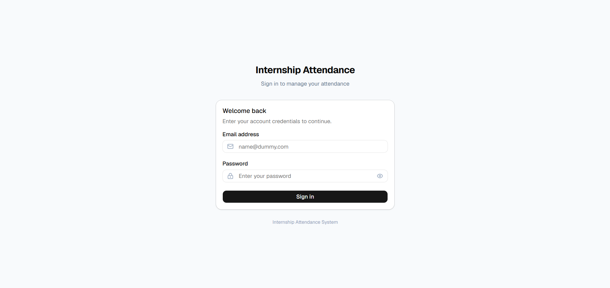
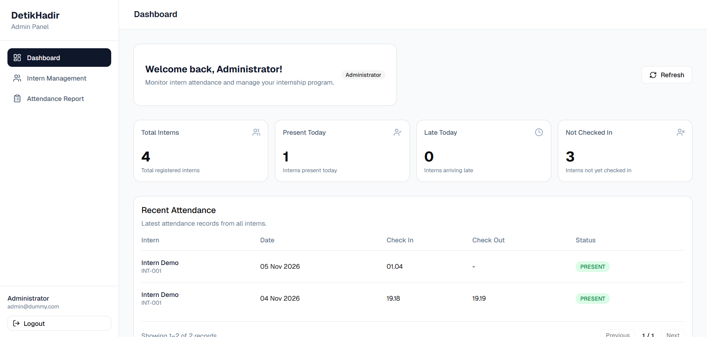
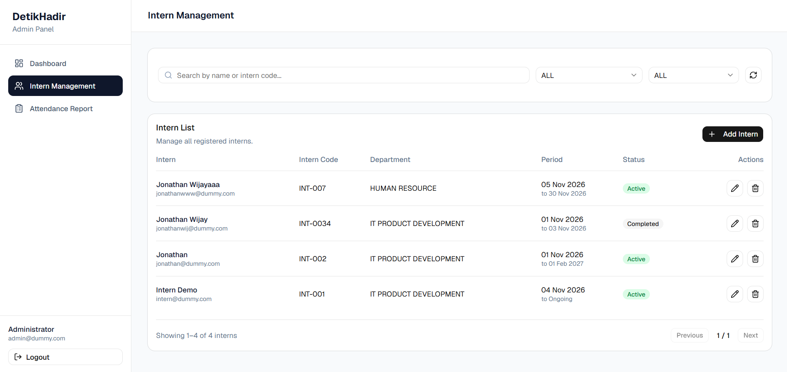
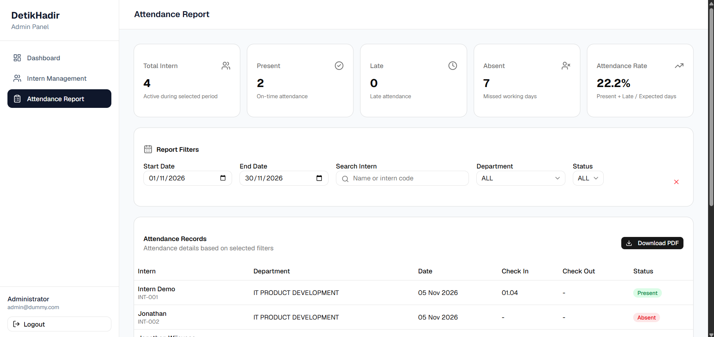
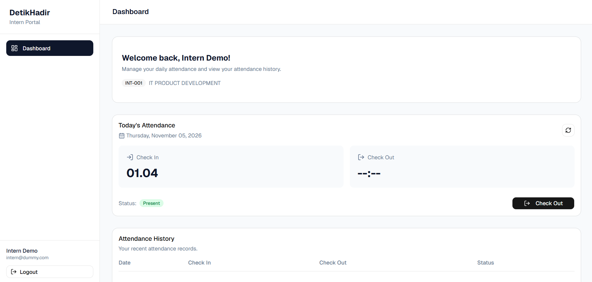

# Dokumentasi Aplikasi Absensi Peserta Magang

## 1. Deskripsi Aplikasi

Aplikasi Absensi Peserta Magang merupakan aplikasi berbasis web yang
digunakan untuk mengelola kehadiran peserta magang secara digital.
Aplikasi memiliki dua jenis pengguna, yaitu **Intern (Peserta Magang)**
dan **Admin**, dengan hak akses dan fitur yang berbeda.

Aplikasi ini dikembangkan menggunakan React, TypeScript, dan Tailwind
CSS pada sisi frontend, Express.js dan TypeScript pada sisi backend,
serta Supabase sebagai layanan autentikasi dan basis data.

## 2. Link Aplikasi

  ----------------------------------------------------------------------------------------------------
  Komponen                            Link
  ----------------------------------- ----------------------------------------------------------------
  Aplikasi Frontend                   https://jonathan-wijaya-fullstack-developer.vercel.app

  Backend API                         https://jonathan-wijaya-backend-detikcom.vercel.app
  
  ----------------------------------------------------------------------------------------------------

## 3. Fitur Aplikasi

### A. Intern (Peserta Magang)

1.  **Login**\
    Peserta magang dapat masuk ke aplikasi menggunakan akun yang telah
    terdaftar.

2.  **Dashboard Intern**\
    Menampilkan informasi dan ringkasan kehadiran peserta magang.

3.  **Check-in**\
    Peserta dapat mencatat waktu kedatangan setiap hari.

4.  **Check-out**\
    Peserta dapat mencatat waktu pulang setelah menyelesaikan aktivitas
    magang.

5.  **Riwayat Absensi**\
    Peserta dapat melihat catatan kehadiran yang telah dilakukan.

### B. Admin

1.  **Dashboard Admin**\
    Menampilkan ringkasan informasi terkait peserta magang dan data
    kehadiran.

2.  **Manajemen Peserta Magang**\
    Admin dapat melihat daftar peserta magang beserta informasi seperti
    nama, kode peserta, dan departemen. Admin juga dapat menambahkan
    data peserta magang.

3.  **Attendance Records**\
    Admin dapat melihat data absensi seluruh peserta magang.

4.  **Filter dan Pencarian**\
    Admin dapat menyaring data berdasarkan rentang tanggal, nama
    peserta, departemen, dan status kehadiran.

5.  **Attendance Report**\
    Menampilkan laporan kehadiran peserta magang, termasuk status
    kehadiran seperti Present, Late, dan Absent.

6.  **Pagination**\
    Data laporan ditampilkan dalam beberapa halaman agar lebih mudah
    dibaca dan dikelola.

7.  **Export PDF**\
    Admin dapat mengunduh laporan absensi dalam format PDF berdasarkan
    filter yang diterapkan.

## 4. Cara Penggunaan

### A. Sebagai Intern

1.  Buka link aplikasi frontend.
2.  Login menggunakan akun peserta magang yang telah disediakan.
3.  Setelah berhasil login, pengguna akan diarahkan ke dashboard intern.
4.  Pilih fitur Check-in untuk mencatat waktu kedatangan.
5.  Setelah aktivitas magang selesai, lakukan Check-out untuk mencatat
    waktu pulang.
6.  Buka riwayat absensi untuk melihat catatan kehadiran.

### B. Sebagai Admin

1.  Buka link aplikasi frontend.
2.  Login menggunakan akun admin yang telah disediakan.
3.  Setelah berhasil login, pengguna akan diarahkan ke dashboard admin.
4.  Buka halaman Interns untuk melihat atau menambahkan peserta magang.
5.  Buka halaman Attendance Records untuk melihat data absensi.
6.  Gunakan filter atau pencarian untuk menemukan data tertentu.
7.  Buka laporan absensi untuk melihat rekap kehadiran.
8.  Gunakan tombol Export PDF untuk mengunduh laporan.

## 5. Status Kehadiran

Aplikasi menggunakan beberapa status untuk mengelompokkan kehadiran
peserta magang:

  -----------------------------------------------------------------------
  Status                              Keterangan
  ----------------------------------- -----------------------------------
  PRESENT                             Peserta melakukan absensi dan
                                      tercatat hadir tepat waktu.

  LATE                                Peserta melakukan absensi dengan
                                      status terlambat.

  ABSENT                              Peserta tidak memiliki catatan
                                      kehadiran pada hari kerja yang
                                      dihitung dalam laporan.
                                      
  -----------------------------------------------------------------------

## 6. Teknologi yang Digunakan

| Teknologi | Penggunaan |
| :--- | :--- |
| React.js | Pengembangan antarmuka frontend |
| TypeScript | Type safety pada frontend dan backend |
| Vite | Build tool frontend |
| Tailwind CSS | Styling antarmuka |
| shadcn/ui | Komponen antarmuka |
| Express.js | Pengembangan REST API |
| Supabase | Autentikasi dan basis data PostgreSQL |
| Axios | Komunikasi frontend dengan backend |
| jsPDF & jsPDF-AutoTable | Ekspor laporan ke PDF |
| Vercel | Deployment frontend dan backend |

## 7. Informasi Tambahan

-   Aplikasi menggunakan autentikasi berbasis token untuk mengelola sesi
    pengguna.
-   Hak akses dibedakan berdasarkan role Admin dan Intern.
-   Setiap peserta magang hanya dapat melakukan absensi sesuai akun
    masing-masing.
-   Data absensi disimpan berdasarkan tanggal sehingga pencatatan
    kehadiran harian dapat dikelola secara terstruktur.
-   Laporan absensi dapat digunakan untuk memantau kehadiran peserta
    magang secara keseluruhan.
-   Check-in hanya bisa dilakukan 1 kali sehari.
-   Check-out hanya bisa dilakukan 1 kali sehari.
-   Check-out hanya bisa dilakukan setelah check-in pada hari yang sama.
-   Peserta Intern baru mendapatkan password default 'intern'

## 8. Akun Demo

Akun untuk pengujian aplikasi dapat menggunakan kredensial berikut:

| Role | Email | Password |
| :--- | :--- | :--- |
| Admin | `[admin@dummy.com]` | `[admin123]` |
| Intern | `[intern@dummy.com]` | `[intern]` |

*Kredensial demo disediakan secara terpisah untuk keperluan pengujian.*

## 9. Tampilan

### Login

### Admin Dashboard

### Admin Intern Management

### Admin Attendance Report

### Intern Dashboard

------------------------------------------------------------------------

**Dikembangkan oleh:** Jonathan Wijaya\
**Assignment:** Fullstack Developer Internship -- Detikcom
